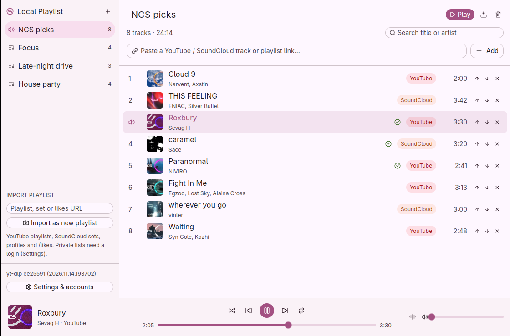
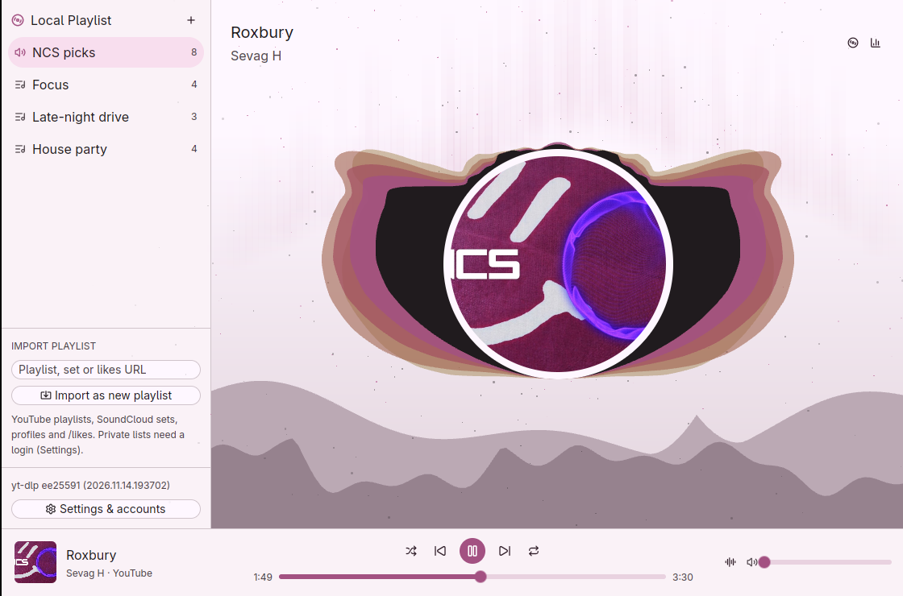
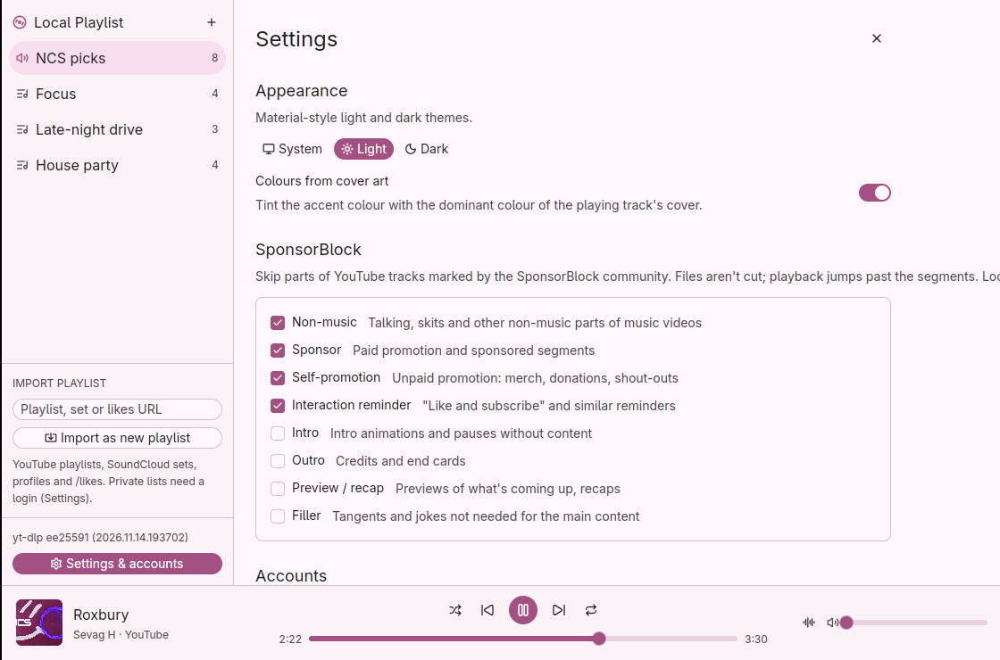

<p align="center">
  
</p>

<h1 align="center">Local Playlist</h1>

<p align="center">
  <a href="https://github.com/jakeayy/local-playlist/releases/latest"></a>
  <a href="https://github.com/jakeayy/local-playlist/releases"></a>
  <a href="https://github.com/jakeayy/local-playlist/pkgs/container/local-playlist"></a>
</p>

A privacy-friendly music player for links from **YouTube / YouTube Music** and
**SoundCloud**. Paste links, build playlists that live on your computer, and listen to
them in the app, also offline. No account, no ads, no tracking.

<picture>
  <source media="(prefers-color-scheme: dark)" srcset="docs/screenshots/playlist-dark.png">
  
</picture>

<table>
  <tr>
    <td>
      <picture>
        <source media="(prefers-color-scheme: dark)" srcset="docs/screenshots/visualizer-dark.png">
        
      </picture>
    </td>
    <td>
      <picture>
        <source media="(prefers-color-scheme: dark)" srcset="docs/screenshots/settings-dark.png">
        
      </picture>
    </td>
  </tr>
  <tr>
    <td align="center">Visualizer</td>
    <td align="center">Settings</td>
  </tr>
</table>

<sub>Music in the screenshots: releases by <a href="https://ncs.io">NoCopyrightSounds</a>.</sub>

## Contents

- [Features](#features)
- [Download](#download)
- [Getting started](#getting-started)
- [Privacy](#privacy)
- [Web version (self-hosted)](#web-version-self-hosted)
- [Help and feedback](#help-and-feedback)
- [License](#license)
- [Star history](#star-history)

## Features

- **One playlist for everything:** YouTube, YouTube Music and SoundCloud tracks side by
  side. Just paste a link.
- **Import whole playlists** from YouTube and YouTube Music, and SoundCloud sets, profiles
  and likes. Public ones don't need a login.
- **Add many links at once:** paste a list (one link per line), take it from the
  clipboard, or open a text file.
- **Starts playing right away**, while the track is still downloading, and the next one
  is ready before the current one ends.
- **Your music, offline:** every track is saved as an ordinary audio file (with its cover)
  in your Music folder, so it also plays without internet and in any other player.
  "Download all" saves a whole playlist at once.
- **Skips the boring parts** of YouTube videos with [SponsorBlock](https://sponsor.ajay.app/):
  talking, sponsors, "like and subscribe" reminders, intros, outros and filler. Or turn it
  off.
- **Lyrics, karaoke style:** the line being sung lights up word by word and stays in the
  middle; click a line to jump to it. Songs without timed lyrics show the plain text.
  Uploads like "Artist - Title (Official Video)" are matched to the right song, and if a
  music video's intro puts the lyrics out of step, shift them for that song (or
  right-click the line being sung).
- **Visualizer:** bars, or a circle over a night sky that moves with the music.
- **Keeps playing in the background:** close the window and the music goes on, with an
  icon in the system tray to bring it back, pause, skip or quit (desktop app).
- **Discord status** (optional, desktop app): show what you're playing on your Discord
  profile, with the cover, how far along it is, and buttons to the song and the project.
- **Light and dark themes**, with colours taken from the cover of what's playing.
- **Removed by mistake?** Removed tracks are kept for a while (up to 2 GB), so adding one
  back is instant.
- **Optional login** for private playlists, YouTube *Liked videos*, *Liked music* and
  *Watch later*, and your SoundCloud likes.
- **Nothing else to install:** on first start the app offers to download the two helpers
  it needs (yt-dlp and QuickJS). **Update bundled components** in Settings gets their
  newest versions.

## Download

Get the latest version from the [Releases page](https://github.com/jakeayy/local-playlist/releases/latest):

- **Windows (64-bit):** download `local-playlist-<version>-windows-x64.zip`, unzip it, and
  run `local-playlist.exe`.
- **Linux (64-bit):** download `local-playlist-<version>-linux-x64.tar.gz`, extract it, and
  run `local-playlist`. It needs a recent distribution (e.g. Ubuntu 24.04, Debian 13,
  Fedora 40 or newer). Logging in also needs WebKitGTK 4.1 (`libwebkit2gtk-4.1-0` on
  Ubuntu/Debian, `webkit2gtk4.1` on Fedora).

Keep `local-playlist-login` next to the app: it's the window you log in with.

Pre-releases are builds of the newest changes. They may be less stable.

## Getting started

1. **Start the app.** The first time, it offers to download yt-dlp and QuickJS; say yes.
2. **Make a playlist** with **+** at the top of the sidebar, or bring one in: paste a
   playlist link under **Import playlist** (at the bottom of the sidebar) and click
   **Import as new playlist**.
3. **Add songs** by pasting a YouTube or SoundCloud link into the box above the track list
   and clicking **Add**. To add many at once, click the list button next to **Add**: paste
   one link per line and click **Add links**, or use **From clipboard** or **From file…**
   (a text file; lines starting with `#` are skipped). Songs already in the playlist
   aren't added twice.
4. **Click a track to play it.** It's saved to your Music folder as it plays (Settings →
   Storage shows where, and lets you change it).

<details>
<summary>Which links work?</summary>

- **YouTube / YouTube Music tracks:** `youtube.com/watch?v=…`, `youtu.be/…`,
  `youtube.com/shorts/…`, `music.youtube.com/watch?v=…`
- **YouTube / YouTube Music playlists:** public or unlisted (`…/playlist?list=…`)
- **SoundCloud:** tracks (`soundcloud.com/artist/track`), sets and albums, a profile's
  tracks, a profile's public likes (`soundcloud.com/artist/likes`), and `on.soundcloud.com`
  short links

With a login, also private playlists, YouTube *Liked videos*, *Liked music* and *Watch
later*, and your own SoundCloud likes.

</details>

To use private playlists or your likes, open **Settings & accounts** and log in. If logging
in doesn't work for you, you can paste cookies from your browser instead; see
[ADDING-COOKIES.md](ADDING-COOKIES.md).

## Privacy

- **Nothing is collected.** There are no accounts, ads, analytics or tracking. Your
  playlists and settings are a file on your computer.
- **The app only talks to** YouTube and SoundCloud (to look up and download tracks),
  SponsorBlock (if turned on), the lyrics databases LRCLIB and lrc.red (only while the
  lyrics page is open), and GitHub (to download yt-dlp and QuickJS).
- **Discord sees what you play only if you turn on the Discord status.** It's off by
  default. When on, the app tells the Discord app on your computer each song's title,
  artist and link, and Discord shows them on your profile (and loads the cover from
  YouTube or SoundCloud, unless you hide it, and the play/pause icon from this project on
  GitHub, itself).
- **SponsorBlock isn't told which video you're playing:** the app asks about a group of
  many videos at once and picks out the right one itself.
- **Lyrics are looked up only when you open the lyrics page,** for the song playing then.
  The lyrics services see that song's title and artist (there's no way to ask for lyrics
  without saying which song), never who you are: no account, key or cookies. Each song is
  looked up once and kept on your computer.
- **Logging in is optional.** Without it, the app uses only what YouTube and SoundCloud
  show to any visitor, and sends no cookies. If you do log in, your login stays on your
  computer, encrypted, with the key in your system keyring (or, without one, in a private
  file). **Log out** deletes it.

<details>
<summary>Technical details</summary>

- Your library is a plain JSON file, `library.json`, in the app's data folder (on Linux
  `~/.local/share/local-playlist/`; Settings shows the exact path).
- Logins are stored in `credentials.bin` next to it, encrypted with ChaCha20-Poly1305. The
  key lives in the system keyring (Secret Service / Windows Credential Manager / macOS
  Keychain), or in a private key file if there is no keyring.
- Metadata comes from each platform's public web endpoints, the same ones their websites
  use for logged-out visitors: YouTube InnerTube and oEmbed, and SoundCloud api-v2 with the
  public web `client_id`. Unless you log in, no cookies are sent or stored.
- Audio is downloaded by yt-dlp into your music folder and played locally. Removed tracks
  wait in the cache folder (on Linux `~/.cache/local-playlist/removed/`) up to the size
  limit set in Settings.
- Network destinations: YouTube, SoundCloud and their CDNs; SponsorBlock
  (`sponsor.ajay.app`, unless turned off), which gets only the first 4 characters of the
  video id's SHA-256 hash; LRCLIB (`lrclib.net`) and lrc.red, with the title, artist and
  length of the song whose lyrics you open; GitHub, to download or update yt-dlp and
  QuickJS; and, only on systems without a ready-made yt-dlp build, PyPI.
- The Discord status (off by default) goes to the Discord app over its local connection
  (a socket or named pipe on this computer), never to Discord's servers directly. Discord
  receives the title, artist, length and link of the song playing, and the address of its
  cover image (unless the cover is hidden); for SoundCloud tracks the app asks SoundCloud
  for that address. With colours from cover art on, the play/pause icon is one in the
  app's accent colour, which Discord loads from this repository
  (`raw.githubusercontent.com`).
- Lyrics are cached in `~/.cache/local-playlist/lyrics/` (on Linux), one small file per
  song.
- The tray icon uses the desktop's StatusNotifierItem tray on Linux (KDE, most other
  desktops, and GNOME with the AppIndicator extension) and the notification area on
  Windows. Without a tray, closing the window quits the app.

</details>

## Web version (self-hosted)

Have a home server? It can run Local Playlist for any browser on your network. Your
playlists stay in each browser; the server only looks up links and lyrics, and streams
the audio.
Logins, private playlists and offline folders are desktop-only.

With Docker:

```sh
docker run -d --name local-playlist -p 8080:8080 -v lp-data:/data \
    -e LOCAL_PLAYLIST_PASSWORD='a long password' ghcr.io/jakeayy/local-playlist:latest
```

Or download the `…-server` version from the Releases page and run
`local-playlist --server`; it asks for a password. Then open `http://<server>:8080`.

- A password (8 characters or more) protects it, and only YouTube and SoundCloud links are
  accepted.
- It doesn't log which links are requested, and deletes cached audio after two hours
  without use (`--cache-minutes`).
- It downloads yt-dlp and QuickJS on first start and updates yt-dlp daily.
- Run it on a home connection: YouTube often blocks servers in data centres.
- To use it from outside your network, put it behind HTTPS (a reverse proxy).
- All options: `local-playlist --server --help`.

## Help and feedback

- **Something broke?** YouTube and SoundCloud change things now and then. Please
  [open an issue](https://github.com/jakeayy/local-playlist/issues/new/choose); there's a
  form for exactly that.
- **Questions and ideas:** [Discussions](https://github.com/jakeayy/local-playlist/discussions).
- **Security problems:** please report them privately; see [SECURITY.md](SECURITY.md).
- **Want to build it yourself or help out?** See [CONTRIBUTING.md](CONTRIBUTING.md).

## License

Copyright (C) 2026 jakeayy and Local Playlist contributors.

Local Playlist is free software: you can redistribute it and/or modify it under the terms
of the GNU General Public License as published by the Free Software Foundation, either
version 3 of the License, or (at your option) any later version. It is distributed
WITHOUT ANY WARRANTY; see [LICENSE](LICENSE) for details.

The bundled Noto Sans fonts are under the SIL Open Font License
([assets/fonts/OFL.txt](assets/fonts/OFL.txt)).

## Star history

<a href="https://www.star-history.com/?repos=jakeayy%2Flocal-playlist">
  <picture>
    <source media="(prefers-color-scheme: dark)" srcset="https://api.star-history.com/svg?repos=jakeayy/local-playlist&type=Date&theme=dark">
    
  </picture>
</a>
